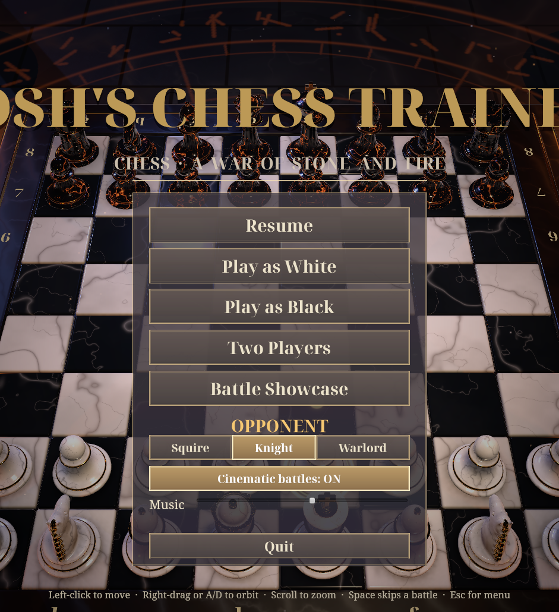
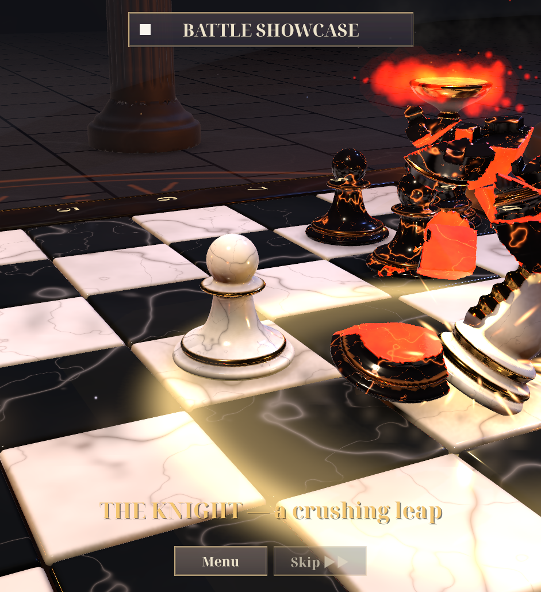

# Josh's Chess Trainer

**Developed by [Host Hobbit](https://hosthobbit.com)**

3D battle chess built in Unity 6 (URP), where every capture is a fight. The pieces don't just get taken: they get beaten up, blown apart and smashed into glowing fragments.

## The battles

| Attacker | How it wins |
|---|---|
| Pawn | Hops up close and headbutts the victim twice. The second blow shatters it |
| Knight | Rears up, leaps high and stomps the victim into fragments with a shockwave |
| Bishop | Levitates, calls down lightning and a pillar of holy light. The victim burns away into embers |
| Rook | Backs up and charges like a battering ram, launching the victim off the board |
| Queen | Spins in the air and fires an arcane barrage, then one colossal exploding orb |
| King | Three hammer blows that dent and crack the victim, then a crushing body-slam |

Checkmate topples and crumbles the losing king. Promotion turns the pawn into a pillar of light.

## Features

- Play against the computer (Squire, Knight or Warlord difficulty) as White or Black, or two players on one screen
- **Hint** button: the engine suggests your best move (the "trainer" part)
- **The Grandmaster's Review**: when a game ends, Master Aldric the wizard rises beside the board and talks you through it out loud. He replays the turning points with glowing arrows (your move, the opponent's punishing reply, the better move), explains what went wrong, praises your best moves and finishes with tips on avoiding the loss next time. The engine analyses every move in the background while you play
- **Talking pieces**: captured pieces plead, complain or crack a joke as the attacker closes in, then scream as they shatter, with a speech bubble over their head. Each piece type has its own voice
- Undo, a move list, a tray of captured pieces with the material count, and a camera you can orbit and zoom
- Battle Showcase mode that plays all six fights back to back
- Full chess rules: castling, en passant, promotion, check, checkmate, stalemate, and draws by the fifty-move rule, threefold repetition and insufficient material. Verified with standard perft tests
- Everything is generated by code: piece sculpts, fracture fragments, textures, materials, the scene and all the music and sound effects

## Playing

**Linux (prebuilt):** run `./build.sh` once, then `./play.sh`.

**Unity Editor:** open the folder with Unity **6000.6.3f1** and press Play. The game scene opens automatically.

Controls: left-click to select and move · right-drag or A/D to orbit · scroll to zoom · Space to skip a battle · Esc for the menu. During the review: Space or → for the next point, ← to go back, Esc to finish. The piece voices and the grandmaster can each be switched off in the menu.

## Building

`./build.sh` regenerates every asset and the scene, then builds the Linux player to `Build/Linux/`. It takes about 3 minutes, and the log goes to `Logs/build.log`. If Unity isn't at `~/Unity/Hub/Editor/6000.6.3f1`, set `UNITY=/path/to/Editor/Unity`.

Voices use [Piper](https://github.com/rhasspy/piper), an offline neural text-to-speech engine. It isn't kept in git: the first `./build.sh` runs `Tools/setup_piper.sh`, which downloads it (~380 MB). The grandmaster speaks live through the Piper copy bundled in the build (falling back to `espeak-ng`, then to subtitles only). The piece voices are pre-made clips in `Resources/Voices`; edit the lines in `Tools/make_voices.py` and run it to regenerate them.

Code lives in `Assets/Kingsfall/`:
- `Scripts/ChessEngine.cs`, `Scripts/ChessAI.cs`: the rules engine and the alpha-beta AI
- `Scripts/Choreographer.cs`: the capture battles, promotion and checkmate animations
- `Editor/KingsfallBuilder.cs`: generates all assets, the scene and the build
- `Scripts/GameReview.cs`: background move analysis and the grandmaster's commentary
- `Scripts/Grandmaster.cs`, `Scripts/Speech.cs`, `Scripts/PieceVoices.cs`: the wizard, live speech and the piece voices
- `Editor/EngineTests.cs`: the perft tests
- `Editor/ReviewTests.cs`: prints the grandmaster's review of a few scripted games

## Enjoying it?

If you like the game, say thanks or buy me a coffee ☕. A ⭐ on this repo goes a long way, or get in touch through **[hosthobbit.com](https://hosthobbit.com)**.

## Voices

The speech engine is [Piper](https://github.com/rhasspy/piper) (MIT). The voices are models from [rhasspy/piper-voices](https://huggingface.co/rhasspy/piper-voices): `en_GB-alan` (the grandmaster), `en_GB-semaine`, `en_GB-jenny_dioco` and `en_GB-northern_english_male` (the pieces). Each model's licence is in its model card.

## Fonts

The UI uses Noto Serif, Noto Serif Display and Noto Sans Symbols 2 (`Assets/Kingsfall/Resources/*.ttf`), licensed under the SIL Open Font License 1.1.

---

© Host Hobbit Ltd
